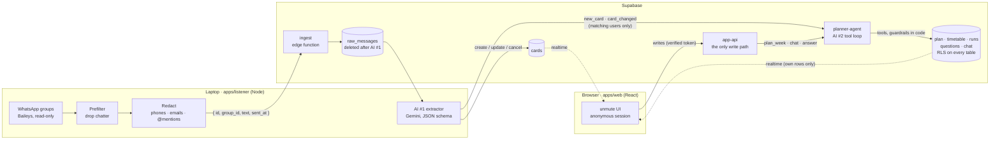

# unmute

**An AI agent that reads your campus WhatsApp groups and plans your next 7 days, without storing anyone's personal data.**

Built in 24 hours for ChronoForge 2026 (Agentic AI track) by **Akshay** (backend, AI, integration) and **Medha** (UI design and frontend).

---

## The problem

Every college student is in dozens of WhatsApp groups: the class group, clubs, the placement cell, the hostel, the fest team. The important messages (a registration that closes tonight, a workshop on Thursday, a class moved to Friday) are buried under "lol", "good morning" and "is it open book?". So students mute the groups, and then miss the deadlines.

We asked students (**40 responses**, Google Form *"How many college groups have you muted?"*):

<!-- SURVEY: replace the ___ with the numbers from the form (Responses → Summary) -->
| Question | Answer |
|---|---|
| How many college WhatsApp groups are you part of? | ___ on average |
| How many of them have you muted? | ___ on average (___ % of their groups) |
| Time spent each day digging through groups for important updates | ___ |
| Missed a deadline, registration or opportunity because the message got buried | **___ %** |
| What they missed | ___ (most common answers) |

## What unmute does

1. **You add a group's invite link.** A bot joins the group and only listens; it never posts.
2. **Chatter is dropped on your laptop.** A privacy filter throws away greetings, jokes and questions, and strips phone numbers, emails and @mentions *before* anything leaves the machine.
3. **AI #1 turns announcements into cards** (deadline · event · opportunity · announcement) with title, times, venue and link, and **deletes the raw text seconds later**. A reminder updates the existing card; "cancelled" cancels it.
4. **AI #2, the planner agent, plans your week.** For each new card that matches your interests, it checks your class timetable and your plan, adds what fits ("Register for HackX", Wed 12:00), and **asks you** when something clashes with a class ("The Amazon talk clashes with PL120N. Move PL120N this week?").
5. **You stay in control.** Answer the question, chat with it ("I'm busy Monday evening"), press *Generate plan* (Balanced or Career focus), or add/remove cards yourself. Every step the agent takes is visible live, with its reason.

Plus: a deadline radar with live countdowns, a feed ranked by your interests and history (with a "why" for every card), and a class-timetable import from a photo or PDF.

## Architecture



| Piece | Where | Job |
|---|---|---|
| Listener | `apps/listener` | WhatsApp → privacy filter → `ingest`; runs AI #1 and fans out to AI #2 |
| `ingest` | `supabase/functions/ingest` | Accepts exactly `{ id, group_id, text, sent_at }` with a secret; anything else (e.g. a sender) is refused |
| `app-api` | `supabase/functions/app-api` | Every browser write: verifies the login token, rate-limits, routes by action |
| `planner-agent` | `supabase/functions/planner-agent` | AI #2: the agent loop, 10 tools, guardrails in code |
| Database | `supabase/migrations` | 12 tables, RLS on all, 3 shared SQL functions (`get_week`, `check_clash`, `get_feed`), realtime |
| Web app | `apps/web` | Medha's UI on live data: every section is a realtime hook, every action goes through `app-api` |

## Why AI #2 is agentic

It isn't a single prompt that returns a plan. The agent **decides which tools to call, sees the results and decides again**, up to 8 steps, until it finishes or asks you something.

| Tool | What it does | Guardrail **in code** (the model can't break it) |
|---|---|---|
| `get_week`, `get_preferences` | Read your week / interests / saved preferences | Only your own rows (user id from the trusted request, never from the model) |
| `check_clash` | Is this time free? | When it isn't, **code computes real free times** that day (the model is bad at finding gaps) |
| `add_entry` | Put something in your week | ≤ 5 writes per run · not in the past · must be clash-free · an **event stays at its real time** (only "Register for X" tasks are flexible) · no duplicates · in auto mode, respects your "nothing after 6 pm" |
| `move_entry`, `remove_entry` | Change entries | In auto mode, **only entries the agent placed**: yours are fixed |
| `save_preference` | Remember "nothing after 18:00" | Only 4 known keys, `HH:MM` |
| `ask_user` | Ask you, with 2–4 buttons | Ends the run; auto mode **can't finish** while a clash with something you own is unasked |
| `finish` | Summary to chat | Ends the run |
| `override_slot` | Move/cancel a class **for one date** | **Only in user mode** (you asked or answered): not even offered to auto runs, and the handler checks again |

- **Two modes.** Runs the agent starts on its own (`new_card`, `card_changed`, `plan_week`) can never touch your timetable or your entries; on a clash, asking is its only option. Runs you start (`chat`, `answer`) may move your things, a class only for one date.
- **Context first.** Before the first model call, code loads the cards, your 7 days and your preferences, so step 1 is already a real decision (~3 round trips saved per run).
- **Observable.** Every step is saved as it happens and shown live under the week ("How the agent decided"): each tool call, ✓ allowed or ✗ refused by code, with the reason.
- **Bounded autonomy.** Safety (no clashes, no timetable changes unless you asked, events at their real time, ≤ 5 writes) is guaranteed in code. The model only decides *quality*: which cards fit you, when to register. The worst a new situation can cause is a weaker plan or an extra question.

## Security & privacy

**Personal chatter never leaves the laptop.** A prefilter drops it and a redactor strips numbers, emails and mentions before anything is stored. Raw text is deleted seconds after AI #1 turns it into a campus card. Every user is an anonymous account, row-level security means you can only read your own plan, and nothing in the browser can write to the database directly: it all goes through one verified function.

| Layer | What we do |
|---|---|
| Collect less | Prefilter on the laptop (on our test set: 23 of 30 chatter messages dropped, **0 of 20** real announcements lost); redaction of phones, emails, @mentions, `wa.me` links; only 4 fields leave the laptop, **no sender, name or number ever** |
| Keep less | `raw_messages` rows deleted right after AI #1; the item card says "original deleted for privacy" instead of quoting it; timetable images are read once and never stored; chat and agent runs older than 7 days are deleted |
| Show less | Anonymous sign-in (no email, password or name); **RLS on all 12 tables**: you read only your own rows (campus cards are the only shared data); `raw_messages` is unreadable from the browser |
| No client writes | No insert/update/delete policies at all; every write goes through `app-api`, which takes the user id **only from the verified token** (a `user_id` in the body is ignored) |
| Secrets | Server-side only; the browser holds a publishable key that RLS limits; `ingest` and `planner-agent` need their own secret (compared in constant time); `.env` files are git-ignored |
| Abuse limits | 5 agent runs / user / minute, 5 group links / user / hour, uploads ≤ 5 MB (PNG/JPEG/PDF), ≤ 8 agent steps |
| Prompt injection | Message and card text is data, never instructions; tested with an "ignore all previous instructions" message (treated as chatter) |
| The bot | Joins only groups a user added; has no code that sends messages |

## Scalability

- **AI #1 runs once per message for everyone**, not once per user, in batches of up to 20.
- **AI #2 runs only for users a card matters to** (matching interests; placement/academic → everyone; changed cards → users who planned them). Cost grows with relevant card × user pairs, not with every user × every message.
- **Stateless edge functions**; rate limits are counted from existing rows, so there's no cache or session store to scale.
- **Shared logic in SQL** (`get_week`, `check_clash`, `get_feed`) runs next to the data, with indexes on the hot queries and RLS-scoped realtime.

## Simplicity

3 edge functions · 10 agent tools · 3 SQL functions · one write path (`app-api`) · **no cron jobs** (data retention happens lazily when you use the app) · one adapter file (`apps/web/src/lib/adapt.js`) between the backend and the UI.

## Results

**AI #1 accuracy**: 50 labelled messages from 9 fake campus groups (20 relevant, 30 chatter, incl. relative dates, a reminder, an extension, a cancellation, a postponement, a forward and a prompt-injection attempt), dry run with `npm run eval`:

| Metric | Score |
|---|---|
| Relevance (card or chatter) | **50 / 50** |
| Card type | **17 / 17** |
| Dates and times, to the minute | **17 / 17** |
| Updates and cancellations hit the right card | **4 / 4** |
| Real announcements dropped by the laptop filter | **0** |

The eval went 76 → 94 → 100 % on type and 71 → 94 → 100 % on dates as we fixed *general* rules found in tests. At 94 % we chose not to tune for one genuinely ambiguous message rather than fit the prompt to the test set.

**End-to-end backend test** on the live project (57 checks: ingest, RLS, every `app-api` action and rejection, rate limit, agent auto/user runs, chat, plan week, timetable import). Every check passed; the one fail in the final run was a test needing a card in an emptied database.

**Real-timetable scenario** (a real 20-class timetable + 10 campus messages through the whole pipeline): chatter dropped on the laptop, phone number redacted, 6 correct cards, free items planned, the clash with a lab asked about, **0 agent entries clashing with the timetable** and **0 timetable changes without the user's answer**. Each run found something (an event moved to an invented time, guessed free slots, an invented deadline), fixed as a general rule, mostly in code.

## Stack

| Part | Tech |
|---|---|
| Frontend | React 19, Vite, Tailwind CSS 4, shadcn/ui (Radix), date-fns, Embla, Sonner |
| Backend | Supabase: Postgres (RLS, SQL functions), Realtime, anonymous Auth, Edge Functions (Deno, TypeScript) |
| AI | Google Gemini via `@google/genai`: JSON-schema output (AI #1, timetable), function calling (AI #2); model set by env, retry + fallback model when busy |
| WhatsApp | Baileys (read-only listener) on Node 22 |

## Setup

You need: Node 22+, a Supabase project (**Authentication → Anonymous sign-ins: on**), a Gemini API key, a spare WhatsApp number.

```bash
git clone https://github.com/Alt0727/Pathfinder_AgenticAI_Engineer.git
cd Pathfinder_AgenticAI_Engineer
```

**1. Database.** Run `supabase/migrations/001_tables.sql` → `004_realtime.sql` in order in the SQL editor.

**2. Edge functions.** Set the function secrets `INGEST_SECRET`, `AGENT_SECRET`, `GEMINI_API_KEY`, `GEMINI_MODEL` (optional `GEMINI_FALLBACK_MODEL`; `SB_SECRET_KEY` if the built-in service key isn't available), then:

```bash
npx supabase link --project-ref <your-ref>
npx supabase functions deploy ingest --no-verify-jwt
npx supabase functions deploy app-api --no-verify-jwt
npx supabase functions deploy planner-agent --no-verify-jwt
```
(`--no-verify-jwt`: each function checks its own secret or the user's token itself.)

**3. Listener.** `apps/listener/.env` (names as in `.env.example`): `SUPABASE_URL`, `SUPABASE_SECRET_KEY`, `INGEST_URL`, `INGEST_SECRET`, `GEMINI_API_KEY`, `GEMINI_MODEL`, `GEMINI_FALLBACK_MODEL`, `AGENT_URL`, `AGENT_SECRET`.

```bash
cd apps/listener && npm install
npm run check     # privacy filter on sample lines (no keys needed)
npm run eval      # AI #1 accuracy on the 50 labelled messages
npm start         # scan the QR with the bot's phone (Linked devices)
```

**4. Web app.** `apps/web/.env.local`: `VITE_SUPABASE_URL`, `VITE_SUPABASE_PUBLISHABLE_KEY`.

```bash
cd apps/web && npm install && npm run dev
```
Open `localhost:5173` → Sign in → pick interests → import your timetable → add a group link. `localhost:5173/?dev` is the backend test page (app-api tests, agent panel, live hook counts).

**Demo reset:** `supabase/reset.sql` deletes all users (and everything they own), cards and raw messages: back to an empty app; reload for a fresh sign-in.

## Limitations (honest) & roadmap

| Today | Next |
|---|---|
| Baileys is an unofficial WhatsApp client: fine for a prototype | Official WhatsApp Business API with partner clubs that opt in |
| The bot technically receives members' messages; we minimise by dropping them on the laptop | Admin-consented partner groups only |
| Free-tier Gemini may use inputs to improve Google's products | Paid tier (no training on data) in production |
| The agent asks one question per run; other clashes come up on the next plan | A questions queue |
| Plan quality varies between runs (safety doesn't: it's enforced in code) | A property-based scenario suite + a post-run safety net that reverts a run breaking an invariant |
| Anonymous accounts are per browser | Optional email login to link devices |
| Timetable import may read both batches' labs | Batch / section picker on import |
| No push notifications | Deadline nudges and a daily plan (cron) |

## Repo map

```
apps/listener/   WhatsApp listener, privacy filter, AI #1, eval (eval/labelled.json)
apps/web/        React app (Medha's UI) · src/lib/adapt.js maps backend rows → UI · src/hooks/ live data · ?dev test page
supabase/        migrations (schema, RLS, SQL functions, realtime) · functions/{ingest, app-api, planner-agent, _shared} · reset.sql
```
